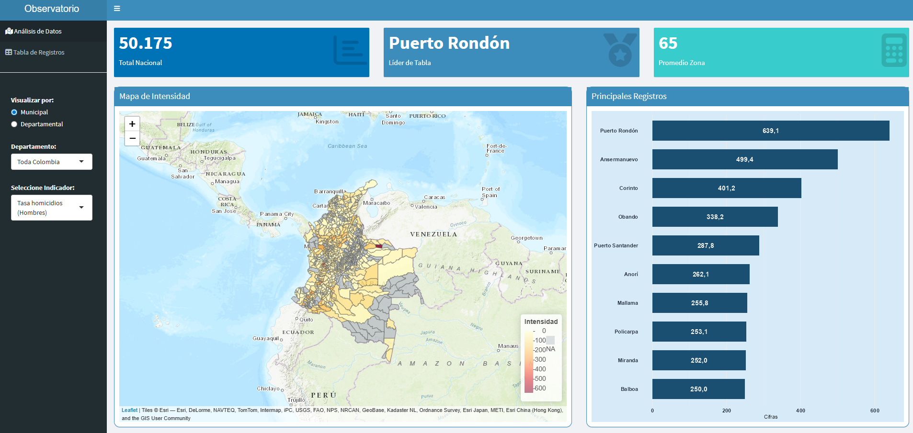

# Colombia Social Indicators Map

**Interactive dashboard built with R Shiny | Academic project, Universidad Tecnológica de Pereira**

🔗 **Live app:** [Open the dashboard](PEGA-AQUI-EL-ENLACE-DE-SHINYAPPS)

An interactive dashboard that maps homicide and birth indicators for every municipality and department in Colombia, so users can compare territories, filter by department and identify the places with the highest values.

## 🎯 Purpose

Official social statistics are usually published as long tables that are hard to compare across territories. This dashboard turns them into a map and a ranking, so anyone can see at a glance where each indicator is concentrated.

## ✨ Features

- **Two levels of analysis:** switch between municipal and departmental views.
- **Department filter:** focus on a single department or the whole country.
- **11 indicators** to choose from (see below).
- **Choropleth map** with a yellow-to-red color scale, labels and pop-ups for each territory.
- **Summary cards:** total, the territory with the highest value and the average for the selected area.
- **Top 10 ranking** of municipalities for the selected indicator.
- **Data table** with search, pagination and all the records.

## 📊 Indicators

| Topic | Indicators |
| --- | --- |
| Homicides | Total cases · rate per 100,000 inhabitants · cases and rates for men and women |
| Births | Total births · mothers under 14 · mothers by education level (without high school, with high school, professional or technical) |

## 🛠️ Tools

R · Shiny · shinydashboard · leaflet · sf · dplyr · ggplot2 · DT

## 📁 Project structure

| File | Description |
| --- | --- |
| `preparar_datos.R` | Cleans the source data, joins it with the municipal and departmental geometries and saves the results as `.rds` files |
| `casos_nacional.rds` | Municipal-level data with geometry |
| `casos_departamental.rds` | Department-level data with geometry |
| `app.R` | Shiny application: interface, map, summary cards, ranking and table |

## ▶️ How to run it locally

1. Download or clone this repository.
2. Open `app.R` in RStudio.
3. Click **Run App**. The required packages are loaded at the top of the script; install any that are missing with `install.packages()`.

## 🧰 Skills demonstrated

Data cleaning and integration · geospatial analysis with `sf` · interactive visualization with `leaflet` · dashboard design with Shiny · reactive programming · data storytelling
